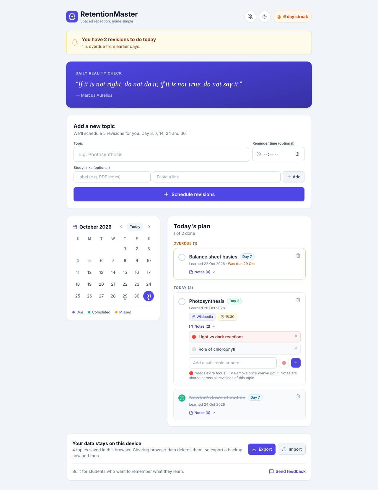
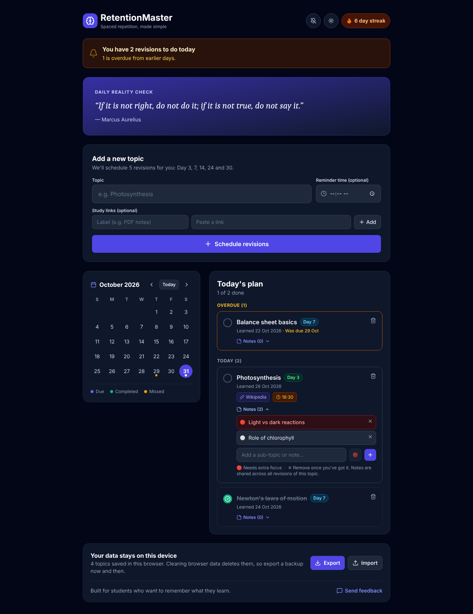
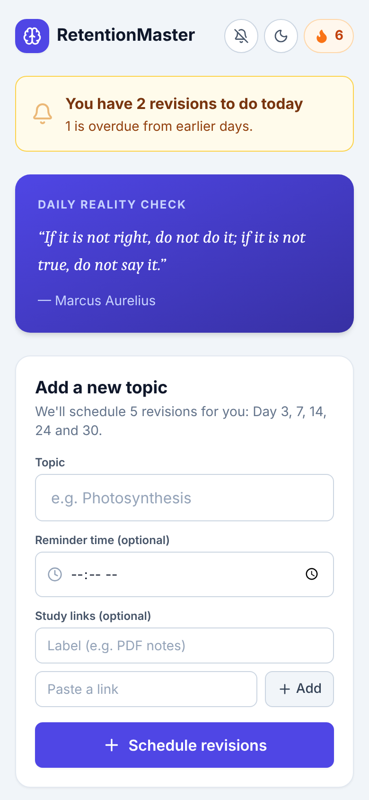
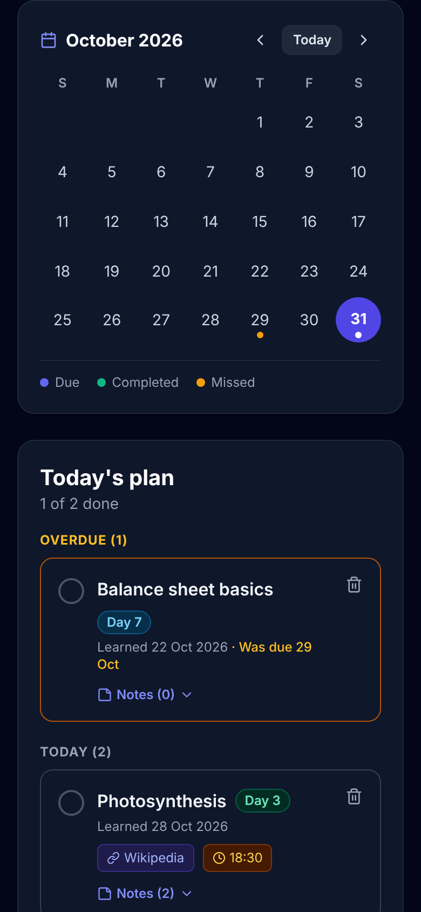

<div align="center">


# RetentionMaster

**Learn it once. Remember it for good.**

A free, no-signup spaced repetition planner for students. Add a topic the day you learn it, and RetentionMaster schedules every revision for you.

[**Open the app →**](https://retention-master.netlify.app)


</div>

<p align="center">
  
  
</p>

## Why spaced repetition?

Most of what we study is forgotten within days unless we review it. Reviewing at growing intervals (a few days, then a week, then a few weeks) moves knowledge into long-term memory with far less total study time than cramming.

The hard part is remembering *when* to review. RetentionMaster handles that for you.

## How it works

1. **Add a topic** on the day you learn it, with optional study links and a reminder time.
2. **Five revisions are scheduled automatically** on Day 3, 7, 14, 24 and 30.
3. **Open the app each day** and tick off what is due. Missed revisions stay at the top of today's plan until you finish them.
4. **After the Day 30 revision**, the app asks whether you still remember the topic. If not, it schedules one more revision 30 days later.

## Features

| Feature | What it does |
| --- | --- |
| Automatic schedule | One topic becomes five revisions on the calendar |
| Overdue tracking | Missed revisions are never hidden; they wait in "Overdue" |
| Calendar view | Dots show due, completed and missed days at a glance |
| Notes per topic | Add sub-topics, flag the ones that need extra focus |
| Study links | Attach PDFs, videos or articles to each topic |
| Reminders | Optional alarm and browser notification at your chosen time |
| Daily streak | Counts consecutive days with every revision done |
| Light and dark mode | Follows your device, or switch with one tap |
| Backup and restore | Export your data to a file and import it on any device |
| Installable app | Add it to your phone's home screen like a native app |

## Install it on your phone

**Android (Chrome):** open the app, tap the **⋮** menu, then **Install app** (or **Add to Home screen**).

**iPhone (Safari):** open the app, tap **Share**, then **Add to Home Screen**.

<p align="center">
  
  &nbsp;&nbsp;
  
</p>

## Privacy

- **No account, no server, no tracking of your study data.** Everything is stored in your own browser (`localStorage`).
- Because data lives on your device, clearing your browser data removes it. Use **Export** at the bottom of the app to keep a backup file.
- Only `http` and `https` links can be saved, so a pasted or imported link can never run code in the app.
- The site uses Google Analytics for anonymous visit counts only.

## Run it locally

You need [Node.js](https://nodejs.org) 18 or newer.

```bash
git clone https://github.com/TKM649/RETENTION-MASTER.git
cd RETENTION-MASTER
npm install
npm run dev
```

Then open the address shown in the terminal (usually `http://localhost:3000`).

To create a production build in `dist/`:

```bash
npm run build
```

## Project structure

```
├── index.html          # Page shell, theme script, PWA links
├── public/             # App icons and web app manifest
├── src/
│   ├── App.tsx         # The whole app: state, scheduling logic and UI
│   ├── index.css       # Tailwind entry and small global styles
│   └── main.tsx        # React entry point
└── docs/screenshots/   # Images used in this README
```

## Feedback

Found a bug or have an idea? Use the **Send feedback** link inside the app, or [open an issue](https://github.com/TKM649/RETENTION-MASTER/issues).
